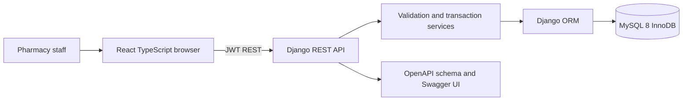
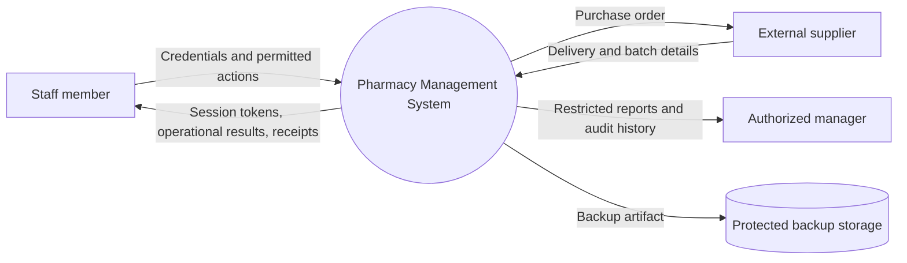
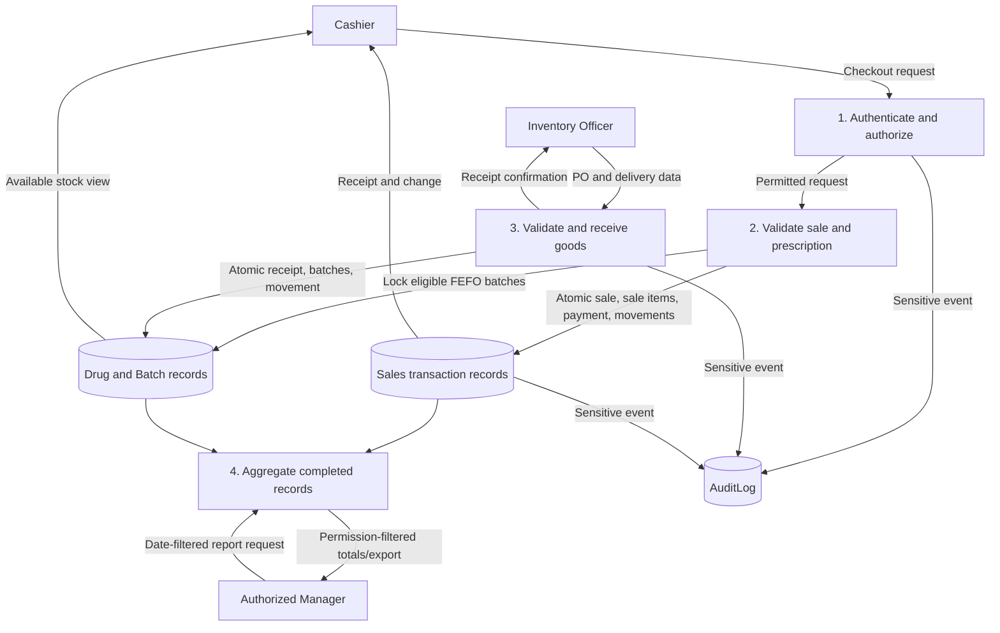
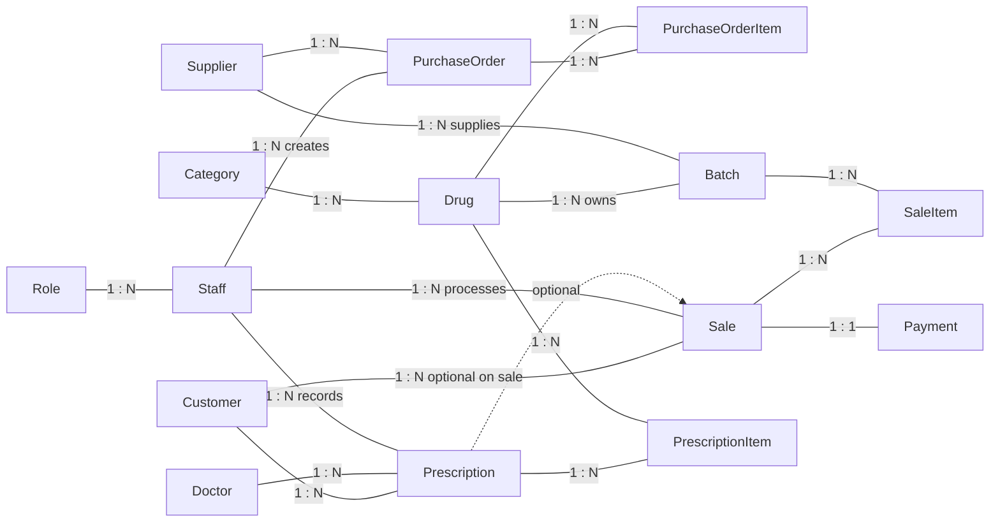
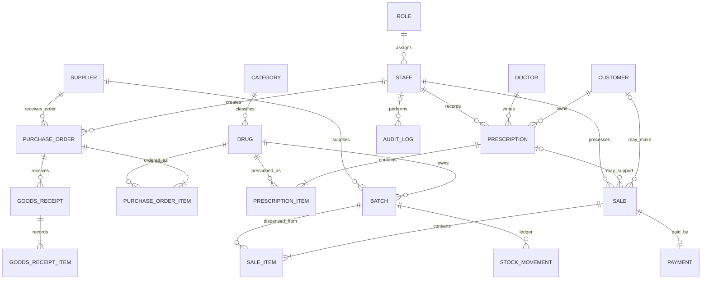

# Database Design Notes

## Boundary and architecture

The system boundary is one pharmacy location. A single API service is authoritative for validation, permissions, business calculations, and transaction boundaries. The browser is not the business database.

## Data-flow diagrams

## Conceptual Chen ERD

Core business entities are rectangles and relationships are diamonds. Cardinalities shown on connectors correspond to the approved model; M:N relationships are resolved by the associative entities listed afterward.

## Logical Crow's Foot ERD

Payment is a normal dependent transaction entity with a one-to-one Sale key, not a conceptually weak entity. Batch is the sole approved weak entity: owner Drug, partial key BatchNumber, conceptual key `(DrugID, BatchNumber)`, physical surrogate `BatchID`, and a unique constraint on `(drug_id, batch_number)`.

## Core relational schema and key attributes

Every core table has surrogate primary key `id`; timestamped records have `created_at` and `updated_at`, except Payment's `recorded_at`.

| Core table | Main attributes and constraints |
|---|---|
| Role | name unique, description, JSON permission keys, active flag |
| Staff | username/auth fields, display name, role FK, active flag |
| Category | unique name, description, active flag |
| Drug | category FK, generic/brand, strength, dosage form, unit, decimal selling price, reorder level, prescription flag, active status |
| Batch | drug and supplier FKs, batch number, expiry date, received and cached available units, status; unique `(drug,batch_number)`, available <= received, FEFO index |
| Supplier | unique name, contact fields, active flag |
| PurchaseOrder | unique order number, supplier/staff FKs, state, ordered timestamp, notes |
| PurchaseOrderItem | purchase-order/drug FKs, quantity, decimal unit cost; unique `(purchase_order,drug)` |
| Customer | minimal name/contact and active flag |
| Doctor | name, optional unique registration number, contact and active flag |
| Prescription | unique reference; customer, doctor, recording staff, date, status, review metadata |
| PrescriptionItem | prescription/drug FKs, authorized quantity, entered dosage/frequency/duration/instructions; unique pair |
| Sale | unique sale number and optional idempotency key; optional customer/prescription; staff, status, completion time, decimal total |
| SaleItem | sale and actual batch FKs, positive whole-unit quantity, price/line-total decimal snapshots |
| Payment | unique one-to-one sale FK, method, decimal amount, tender/change, manual reference, recording staff/time |

## Implementation extensions

- `GoodsReceipt` and `GoodsReceiptItem`: preserve partial delivery events, request idempotency, PO-item allocation, and receipt-to-batch traceability. Necessary because ordered quantity is not the same event as goods received.
- `StockMovement`: append-style quantity deltas tied to a batch, reason, reference, and staff member. Balances are only updated by audited services.
- `AuditLog`: records sensitive action metadata while deliberately avoiding patient details, credentials, or tokens.
- Django auth/session/admin framework tables are framework support, not approved core entities.

## Normalization and snapshots

The core operational relations are designed to 3NF: each table represents one fact type; non-key attributes depend on that table's key, the whole key, and no other non-key attribute. Repeated drug facts are kept in Drug rather than copied into each order, prescription, or batch. M:N relations are represented by PurchaseOrderItem, PrescriptionItem, and SaleItem. Contact, role, supplier, doctor, category, and transaction facts are not embedded as repeating columns.

Deliberate historical snapshots: SaleItem unit price and line total preserve checkout-time price, while PurchaseOrderItem unit cost preserves the ordered price. Sale total and Batch.available_quantity are cached/derived for efficient use. Checkout recomputes prices and totals server-side under transaction; receipt/sale/adjustment movement rows and transactional balance updates are the audit trail. A future reconciliation job should compare balances to received quantities less sale/adjustment deltas.

## Supplier-per-batch limitation

The approved model assigns one Supplier to each Batch and enforces it here. If one manufacturer batch arrives through multiple suppliers, this loses source-level provenance. Future extension: make Batch represent manufacturer identity only, then relate supplier and receipt through a `BatchSupplySource`/receipt-item association with source-specific prices and quantities. This version does not silently reinterpret the approved model.

## Time and expiry

Database timestamps use UTC-aware Django values. Business reports/display use `Africa/Kampala`. Batch expiry is by local business date: expiry date equal to today is eligible that day; strictly earlier dates are expired. MySQL boundary behavior must still be integration-tested.
